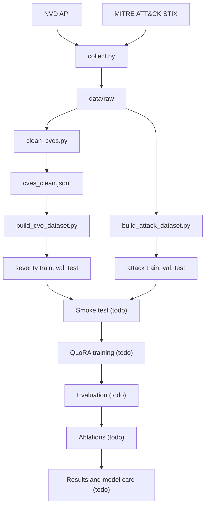

# cyber-slm

Fine-tuning a small language model on cybersecurity data. Two tasks are planned:

- **CVE severity:** given a CVE description, predict its CVSS v3 base severity (`CRITICAL`, `HIGH`, `MEDIUM`, `LOW`).
- **ATT&CK mapping:** given a description of attacker behaviour, name the MITRE ATT&CK technique.

Data sources are the NVD (CVEs 2022 to 2025) and MITRE ATT&CK Enterprise (STIX).
Only the data pipeline is written so far. No model has been trained and no results exist yet.

New to the terms? See the [glossary](docs/glossary.md).

## Pipeline



## Stages

| Stage | Topic | Status |
|---|---|---|
| [01](docs/stage-01-setup/README.md) | Setup | Done |
| [02](docs/stage-02-data-collection/README.md) | Data collection | In progress (MITRE downloaded; NVD files not finished) |
| [03](docs/stage-03-data-cleaning/README.md) | Data cleaning | In progress (ran on missing input; output is empty) |
| [04](docs/stage-04-dataset-building/README.md) | Dataset building | In progress (ATT&CK done, severity waits on stage 03) |
| [05](docs/stage-05-smoke-test/README.md) | Smoke test | Todo |
| [06](docs/stage-06-qlora-training/README.md) | QLoRA training | Todo |
| [07](docs/stage-07-evaluation/README.md) | Evaluation | Todo |
| [08](docs/stage-08-ablations/README.md) | Ablations | Todo |
| [09](docs/stage-09-results-and-model-card/README.md) | Results and model card | Todo |
| [10](docs/stage-10-extensions/README.md) | Extensions | Todo |

Also: [glossary](docs/glossary.md), [interview Q&A](docs/interview-qa.md) (empty for now).

## Quick start

```
python -m venv .venv
.venv\Scripts\activate
pip install -r requirements-data.txt
python src\collect.py
python src\clean_cves.py
python src\build_cve_dataset.py
python src\build_attack_dataset.py
```

Optional: add `NVD_API_KEY=...` to a `.env` file for faster downloads.

## Results

**No model has been trained or evaluated yet, so there are no model metrics.** The only results files in `results/` are `ablations.md` and `ablations_data_size.png`, and they were generated before any run: every ablation row says "not run" and the plot is empty. Nothing below is a model result.

What is real today, from `data/processed/stats.json`:

| ATT&CK dataset | Examples | Share |
|---|---|---|
| train | 13,139 | 80.0% |
| validation | 1,642 | 10.0% |
| test | 1,642 | 10.0% |

- 16,423 "uses" examples were kept from 21,822 relationships in the STIX file. Cleaning and duplicate removal changed no counts.
- Validation and test each contain 9 techniques that never appear in train.
- The severity dataset is empty: `cves_clean.jsonl` and `severity_*.jsonl` are 0 bytes because the NVD download is not finished.

When runs exist, the numbers will come from `results/*.json`, `results/ablations.md` and the plots in `results/`. The model card draft is [MODEL_CARD.md](MODEL_CARD.md). It has `TODO` markers where measured values go.

## Limitations

- **No training or evaluation exists yet.** This repo has no metrics. Stages 05 to 10 are skeletons.
- **The scripts were checked only in parts.** The helper functions were tried on small samples. The full pipeline has not been confirmed end to end, and no counts are recorded.
- **Labels come from scores, not truth.** Severity is the CVSS v3 label from the NVD, or from the CNA if the NVD has none. Scores can differ between sources and are partly a judgement.
- **Severity from text alone is limited.** A description does not always contain what the score is based on.
- **Newer CVEs may lack a v3 score** and are dropped. This can bias the data toward older or better-analysed CVEs.
- **Train and test come from different dates.** This is fairer, but writing style and flaw types change over time.
- **Near-duplicate removal uses a threshold (about 0.85).** Some similar texts may remain and some different ones may be dropped.
- **The train cap per class (2000) is an untuned starting value.**
- **ATT&CK data covers the Enterprise matrix only.** Each example has one technique as the answer, and the text comes from MITRE's own "uses" descriptions, which are short and uneven across groups.
- **The ATT&CK split by group may not be exactly 80/10/10** when a few groups have many examples.
- **Built for an 8 GB RAM laptop.** The scripts read data in pieces to save memory.
- **Requirements are not pinned.** Package versions may change behaviour later. The laptop uses `requirements-data.txt` (data stages). Google Colab uses `requirements-train.txt` (training and evaluation), which leaves out `torch` because Colab already has it.
