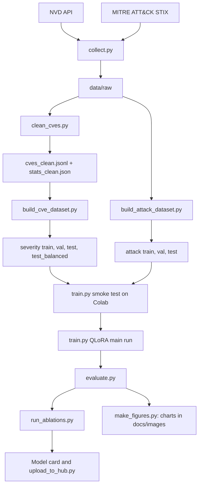
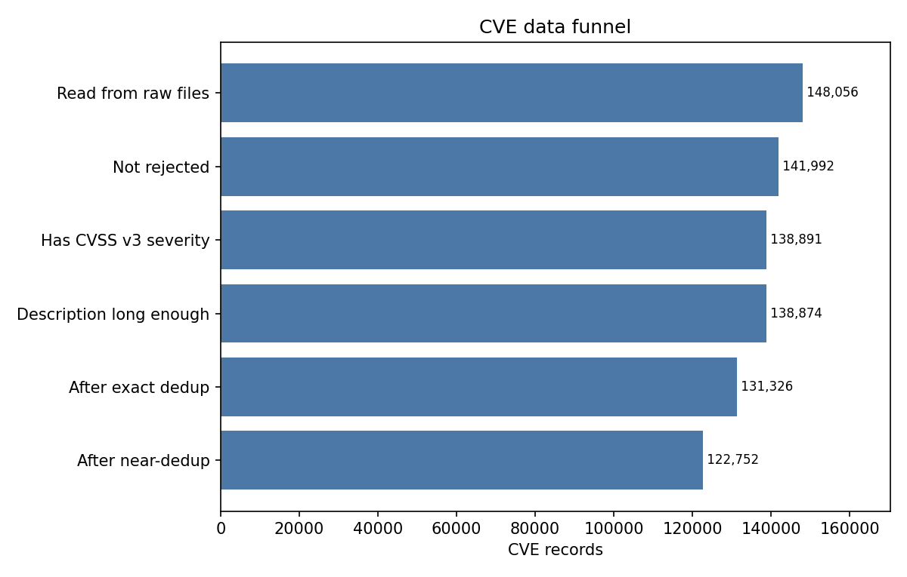
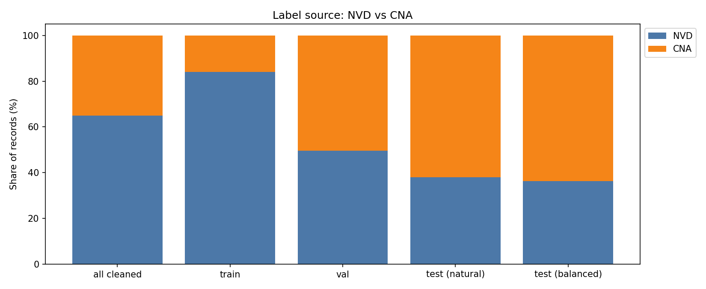
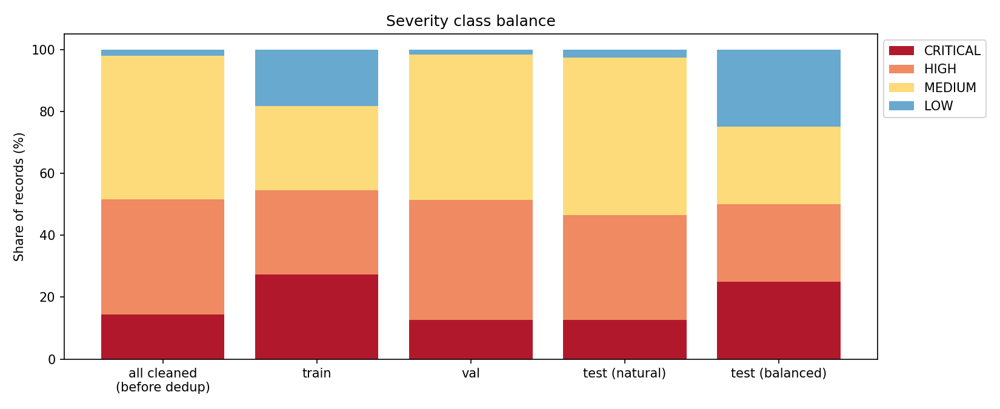
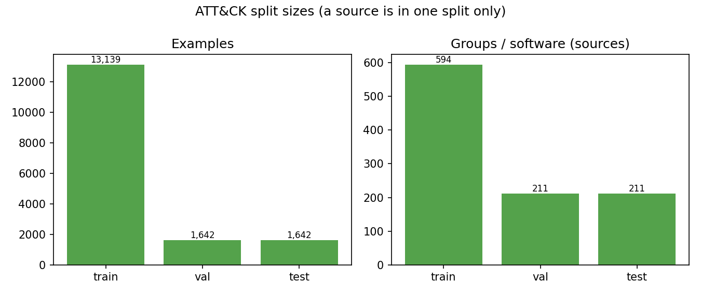

# cyber-slm: fine-tuning a small language model on cybersecurity data

I am learning LLM fine-tuning by building this project step by step. The goal is a small model, trained with QLoRA, for two tasks:

- **CVE severity:** given a CVE description, predict its CVSS v3 base severity (`CRITICAL`, `HIGH`, `MEDIUM`, `LOW`).
- **ATT&CK mapping:** given a description of attacker behaviour, name the MITRE ATT&CK technique.

Data comes from the NVD (CVEs published 2022 to 2025) and MITRE ATT&CK Enterprise (STIX). Only public data is used, for defensive and educational purposes.

**Where things stand:** the data pipeline is built and both datasets (CVE severity and ATT&CK) are measured. Training, evaluation and ablation code is written but has not run, so there are no model results yet. Every number in these docs comes from a file in this repo. Anything that has not run says "Pending".

Docs: [documentation index](docs/README.md) | [journal (the story)](docs/journal.md) | [errors and fixes](docs/errors-and-fixes.md) | [metrics ledger](docs/metrics.md) | [glossary](docs/glossary.md)

## Pipeline



## Status

| Stage | Status | Key metric | Page |
|---|---|---|---|
| 01 Setup | Done | Two requirements files (laptop, Colab) | [stage 01](docs/stage-01-setup/README.md) |
| 02 Data collection | Done | 148,056 CVEs downloaded; 21,822 ATT&CK relationships | [stage 02](docs/stage-02-data-collection/README.md) |
| 03 Data cleaning | Done (re-run Pending) | 138,874 clean CVE records | [stage 03](docs/stage-03-data-cleaning/README.md) |
| 04 Dataset building | Done | CVE 7,343 / 1,000 / 1,000 (+600 balanced test). ATT&CK 13,139 / 1,642 / 1,642 | [stage 04](docs/stage-04-dataset-building/README.md) |
| 05 Smoke test | In progress (code ready, not run) | Pending | [stage 05](docs/stage-05-smoke-test/README.md) |
| 06 QLoRA training | In progress (code ready, not run) | Pending | [stage 06](docs/stage-06-qlora-training/README.md) |
| 07 Evaluation | In progress (code ready, not run) | Pending | [stage 07](docs/stage-07-evaluation/README.md) |
| 08 Ablations | In progress (code ready, not run) | Pending | [stage 08](docs/stage-08-ablations/README.md) |
| 09 Results and model card | In progress (draft card) | Pending | [stage 09](docs/stage-09-results-and-model-card/README.md) |
| 10 Extensions | Todo | None | [stage 10](docs/stage-10-extensions/README.md) |

## Key results so far

Data only. There are no model results yet. Full tables are in [metrics.md](docs/metrics.md).

**CVEs downloaded per year:** 2022: 26,431. 2023: 30,949. 2024: 40,704. 2025: 49,972. Total 148,056.

**CVE cleaning funnel:** 148,056 read, 141,992 not rejected, 138,891 with a CVSS v3 severity, 138,874 with a long enough description.



**Severity before duplicate removal:** CRITICAL 19,911 (14.3%), HIGH 51,750 (37.3%), MEDIUM 64,383 (46.4%), LOW 2,828 (2.0%), NONE 2 (now dropped). LOW is rare, so I will report macro-F1 and test on a class-balanced set as well.

**CVE dataset:** after duplicate removal 122,752 records remain (7,546 exact and 8,574 near-duplicates removed). Final sets: train 7,343 (2,000 each of CRITICAL, HIGH, MEDIUM and 1,343 LOW), validation 1,000, natural test 1,000 and balanced test 600 (150 per class). The train-leak check removed 0 records. The natural validation and test files hold only 17 and 26 LOW examples.

**Label source:** NVD 90,275, CNA 48,599 overall. It shifts between splits: final train is 84.0% NVD scores (6,170 of 7,343), the natural test file is 62.1% CNA scores (621 of 1,000). This is the biggest data problem I have found so far.





**ATT&CK:** 21,822 relationships in the file, 18,975 active "uses", 16,423 usable examples. Split by group or software, so none is in two splits:

| Split | Examples | Sources | Techniques not seen in train |
|---|---|---|---|
| train | 13,139 | 594 | 0 |
| val | 1,642 | 211 | 9 |
| test | 1,642 | 211 | 9 |



## How to run (data stages, on the laptop)

From the project folder:

```
python -m venv .venv
.venv\Scripts\activate
pip install -r requirements-data.txt
python src\collect.py
python src\clean_cves.py
python src\build_cve_dataset.py
python src\build_attack_dataset.py
python src\make_figures.py
```

Training and evaluation run on Google Colab with `requirements-train.txt` (see [stage 05](docs/stage-05-smoke-test/README.md)). A `.env` file with `NVD_API_KEY=<your key>` is optional and speeds up the download. Secrets stay in `.env` or Colab Secrets and never go into the repo.

## Limitations

- **No model has been trained or evaluated.** There are no metrics. Stages 05 to 09 are code and plans.
- **Labels are CVSS scores, not ground truth.** They are partly a judgement and can differ between the NVD and CNAs. About 65% of the cleaned records have an NVD score and about 35% a CNA score.
- **The label source shifts between train and test.** Final train is 84.0% NVD scores and the natural test file is 62.1% CNA scores. A lower test score could come from this shift and not from the model. I have not checked why the mix shifts.
- **The classes are uneven.** LOW is about 2% of the cleaned records, and the natural validation and test files hold only 17 and 26 LOW examples, so LOW scores there are noisy. The balanced test file (150 per class) is the check for rare classes.
- **A description does not always hold what the score depends on,** so some severity errors cannot be avoided from text alone.
- **CVEs without a v3 score are dropped,** which can bias the data.
- **Train and test come from different dates.** This is fairer, but writing style and flaw types change over time.
- **Near-duplicate removal uses a threshold (0.85).** Some similar texts may remain and some different ones may be dropped.
- **The train cap per class (2000) is an untuned starting value.**
- **ATT&CK data is the Enterprise matrix only.** Each example has one technique as the answer, and the texts are MITRE's short "uses" descriptions, uneven across groups. The split by group may not be exactly 80/10/10.
- **`data/processed/stats_clean.json` was filled by hand once** from the console output of an earlier cleaning run. The severity and source counts match a re-count of `cves_clean.jsonl`. Running `clean_cves.py` again replaces it with script-written numbers.
- **Built for an 8 GB RAM laptop.** The scripts read data in pieces.
- **Requirements are not pinned.** Versions may change behaviour later.

## The story in 10 lines

1. I set up the project and wrote a collector for the NVD and MITRE ATT&CK data.
2. My first collector saved too little, so the cleaner could not work. I saved full records instead.
3. The NVD answered 404 while `curl` worked. A placeholder API key in `.env` was being sent as a real key. Now an empty or placeholder key means no key.
4. Rate limits, a half-written file and a corrupt year file taught me to retry with backoff, write to `.part` first and check every file.
5. I cleaned 148,056 CVEs down to 138,874 and saw that LOW is only 2.0% of them.
6. I built the ATT&CK dataset (16,423 examples), split by group so no group is in two splits.
7. I split CVEs by time and removed near-duplicates to avoid leakage.
8. I wrote the training, evaluation and ablation code, then learned it must run on Colab, not on my laptop.
9. I stopped publishing tables with placeholders and now write "Pending" until a number is measured.
10. I built the CVE sets (7,343 / 1,000 / 1,000 plus a balanced test of 600) and saw that train labels are mostly NVD while test labels are mostly CNA. Next: the smoke test on Colab. Read the whole story in the [journal](docs/journal.md).
