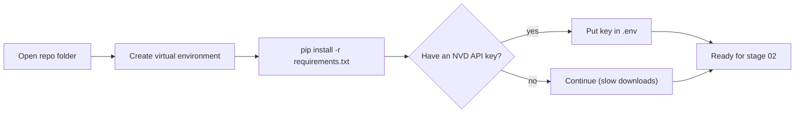

# Stage 01: Setup

**Status:** Done

Previous: none | Home: [README](../../README.md) | Next: [Stage 02: Data collection](../stage-02-data-collection/README.md)

## Goal

Get the folders, Python packages and optional NVD key ready.
After this, every later stage can run with one command.

## Concepts

- A [virtual environment](../glossary.md#virtual-environment) keeps this project's packages separate from other projects.
- `requirements.txt` lists the packages to install. Versions are not pinned yet.
- An [API key](../glossary.md#api-key) is optional. It makes the NVD download much faster because the [rate limit](../glossary.md#rate-limit) is higher. It goes in a `.env` file ([environment variable](../glossary.md#environment-variable-env)).
- `.gitignore` keeps big or secret files out of git: raw data, model weights and `.env`.

## Flowchart



## What the code does

There is no Python code in this stage. These files set up the project:

| File | Job |
|---|---|
| [requirements.txt](../../requirements.txt) | Packages: `requests` (web calls), `python-dotenv` (reads `.env`), `datasketch` (MinHash and LSH, used in stage 04). |
| [.gitignore](../../.gitignore) | Ignores `data/raw/*`, model weight files, `.env` and Python caches. |
| [configs/dataset.json](../../configs/dataset.json) | Settings for the dataset builder (caps, dedup threshold, split dates, seed). Used in stage 04. |

Folders:

| Folder | Holds |
|---|---|
| `data/raw/` | Downloads (git-ignored) |
| `data/processed/` | Cleaned data, datasets and stats |
| `src/` | The scripts |
| `configs/` | Settings files |
| `notebooks/` | Experiments (empty for now) |
| `results/` | Metrics and outputs (empty for now) |
| `docs/` | This learning path |

## How to run

```
cd C:\Users\Preeti\Desktop\cyber-slm
python -m venv .venv
.venv\Scripts\activate
pip install -r requirements.txt
```

Optional: create a file named `.env` in the repo root with this line:

```
NVD_API_KEY=your-key-here
```

You can request a key from the [NVD site](https://nvd.nist.gov/developers/request-an-api-key).

## Results

- Python version used: _fill after run_
- Packages installed without errors: _fill after run_

## Common errors and fixes

| Error | Fix |
|---|---|
| `.venv\Scripts\activate` is blocked by PowerShell | Run `Set-ExecutionPolicy -Scope CurrentUser RemoteSigned`, then activate again. |
| `ModuleNotFoundError: No module named 'datasketch'` | The environment is not active, or install was skipped. Activate it and run `pip install -r requirements.txt`. |
| `python` is not found | Install Python 3 and tick "Add to PATH", or use `py` instead of `python`. |
| The key in `.env` seems ignored | The file must be in the repo root and the line must be exactly `NVD_API_KEY=...` with no quotes or spaces. |

## Self-check questions

1. Why use a virtual environment instead of installing packages globally?
2. What is in `.gitignore`, and why should `.env` be there?
3. What does the NVD API key change?
4. Which stage uses `configs/dataset.json`?
