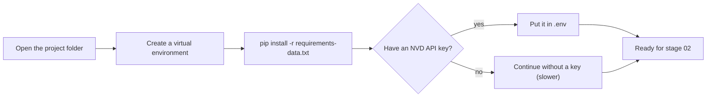

# Stage 01: Setup

**Status:** Done

## Goal

I set up the folders, a Python environment and the packages, so every later stage runs with one command.
I also learned to keep secrets out of the code.

## Concepts

- A [virtual environment](../glossary.md#virtual-environment) is a private box of Python packages for one project.
- There are two requirements files because there are two places to run. `requirements-data.txt` is for my laptop (data stages 02 to 04). `requirements-train.txt` is for Google Colab (training and evaluation). It has no `torch`, because Colab already has it. Versions are not pinned yet.
- An [API key](../glossary.md#api-key) is optional. With an NVD key the download is much faster, because the [rate limit](../glossary.md#rate-limit) is higher. The key lives in a `.env` file ([environment variable](../glossary.md#environment-variable-env)). `.env` is in `.gitignore`.
- Secrets never go into code, docs, screenshots or the terminal output. On Colab I use Colab Secrets. If a secret is ever exposed, I revoke it ([E13](../errors-and-fixes.md#e13)).

## Flowchart



## What the code does

No Python code runs in this stage. These files set the project up:

| File | Job |
|---|---|
| [requirements-data.txt](../../requirements-data.txt) | Laptop packages: `requests`, `python-dotenv`, `datasketch`, `pyyaml`, `scikit-learn` (for the TF-IDF baseline) |
| [requirements-train.txt](../../requirements-train.txt) | Colab packages: `transformers`, `trl`, `peft`, `bitsandbytes`, `datasets`, `accelerate`, `wandb`, `matplotlib`, `scikit-learn`, `pyyaml` |
| [.gitignore](../../.gitignore) | Keeps raw data, model weights, `.env` and caches out of git |
| [configs/dataset.json](../../configs/dataset.json) | Settings for the dataset builder (used in stage 04) |

| Folder | Holds |
|---|---|
| `data/raw/` | Downloads (git-ignored) |
| `data/processed/` | Clean data, datasets and stats files |
| `src/` | The scripts |
| `configs/` | Settings files |
| `notebooks/` | The Colab notebook |
| `results/` | Metrics and plots from real runs |
| `docs/` | These docs, with charts in `docs/images/` |

## How to run

Go to the project folder first (see [E01](../errors-and-fixes.md#e01)), then:

```
python -m venv .venv
.venv\Scripts\activate
pip install -r requirements-data.txt
```

Optional, in a file named `.env` in the project root:

```
NVD_API_KEY=<your key>
```

On Colab, the notebook `notebooks/run_on_colab.ipynb` installs `requirements-train.txt` and reads the tokens from Colab Secrets.

## Results and metrics

Nothing is measured in this stage. See [metrics.md](../metrics.md) for the stages that are.

## Errors faced in this stage

- [E01](../errors-and-fixes.md#e01): commands run from the wrong folder.
- [E12](../errors-and-fixes.md#e12): README saved as UTF-16, so it looked garbled.
- [E13](../errors-and-fixes.md#e13): a secret was shown on screen.

## What I learned

- Check which folder I am in before I run a command.
- Save text files as UTF-8.
- Secrets live in `.env` or Colab Secrets, and I never print them.

## Navigation

Previous: none | [Home](../../README.md) | Next: [Stage 02: Data collection](../stage-02-data-collection/README.md)
