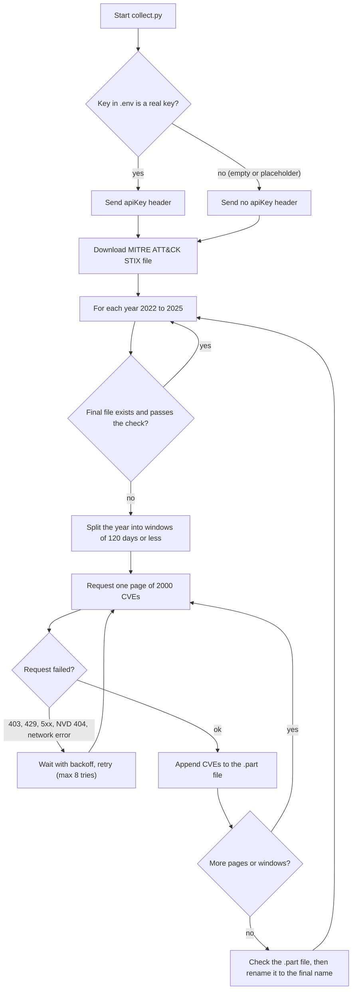

# Stage 02: Data collection

**Status:** Done

## Goal

I download every CVE published from 2022 to 2025 from the NVD, and the MITRE ATT&CK data.
I save them in `data/raw/` without changing them.

## Concepts

- A [CVE](../glossary.md#cve) is a public record of one security flaw. The [NVD](../glossary.md#nvd) adds a [CVSS](../glossary.md#cvss) score and serves the records through a web API.
- [MITRE ATT&CK](../glossary.md#mitre-attck) lists attacker techniques. It is published as one [STIX](../glossary.md#stix) JSON file.
- The NVD has a [rate limit](../glossary.md#rate-limit): 5 requests per 30 seconds without a key, 50 with one. The script waits between calls.
- The NVD answers only date ranges of up to 120 days, so each year is cut into windows and read page by page (2000 CVEs per page).
- When a request fails for a short time, the script waits and tries again, with [exponential backoff](../glossary.md#exponential-backoff).
- An API key that is not a real key can break the request. The NVD answered HTTP 404 when my `.env` held a placeholder ([E03](../errors-and-fixes.md#e03)).
- A half-written file must never have its final name. Each year goes to a `.part` file first.

## Flowchart



## What the code does

[src/collect.py](../../src/collect.py):

- **Settings:** years 2022 to 2025, page size 2000, 120-day windows, 8 tries, backoff 10 seconds up to 300 seconds.
- `clean_api_key(raw)`: returns a key only if it looks like a real NVD key (a UUID, with quotes and spaces removed). An empty or placeholder value gives no key, and then no `apiKey` header is sent. It prints a warning but never the value.
- `backoff_delay(attempt)`: 10, 20, 40, 80, 160, then 300 seconds.
- `get_with_retry(url, params, headers)`: waits so calls are spaced (0.7 s with a key, 6.5 s without), sends the request, and retries on network errors, HTTP 403, 429, any 5xx, and HTTP 404 from the NVD endpoint. It uses `Retry-After` when the server sends it. On any 404 it prints the request URL, the header names (never their values) and the response body.
- `date_windows(year)` and `fmt(dt)`: build the 120-day windows and the date format the NVD wants.
- `collect_nvd()`: for each year it writes the full NVD record of every CVE into `nvd_cves_<year>.json.part`, checks the file, and renames it. A final file that already exists is checked first, and if it is broken it is moved to `.json.corrupt` and downloaded again.
- `validate_year_file(path)`: reads the file line by line, parses every record and returns the count. It raises an error if the file is cut short or has a broken record ([E06](../errors-and-fixes.md#e06)).
- `collect_mitre()`: downloads the ATT&CK Enterprise bundle to `mitre_enterprise_attack.json`.

Output in `data/raw/`:

| File | Content |
|---|---|
| `nvd_cves_2022.json` to `nvd_cves_2025.json` | A JSON list of full NVD CVE records, one file per year |
| `mitre_enterprise_attack.json` | The ATT&CK STIX bundle |

## How to run

From the project root, with the environment active. Run only one collector at a time ([E05](../errors-and-fixes.md#e05)).

```
python src\collect.py
```

To download a year again, delete its file in `data/raw/` first.

## Results and metrics

Source: [metrics.md](../metrics.md) and `data/processed/stats_clean.json`. Each yearly file passed `validate_year_file()` with the same count.

| Year | CVEs downloaded |
|---|---|
| 2022 | 26,431 |
| 2023 | 30,949 |
| 2024 | 40,704 |
| 2025 | 49,972 |
| Total | 148,056 |

Run time: not recorded.

## Errors faced in this stage

- [E01](../errors-and-fixes.md#e01): wrong folder.
- [E02](../errors-and-fixes.md#e02): the first collector saved too little, so I saved full records.
- [E03](../errors-and-fixes.md#e03): HTTP 404 from the NVD while `curl` got 200. Cause: a placeholder `NVD_API_KEY` sent as a real key.
- [E04](../errors-and-fixes.md#e04): HTTP 429 rate limit.
- [E05](../errors-and-fixes.md#e05): a `.part` file left behind and two collectors at once.
- [E06](../errors-and-fixes.md#e06): the 2022 file could not be read.
- [E13](../errors-and-fixes.md#e13): a secret shown on screen.
- [E16](../errors-and-fixes.md#e16): the first download run was interrupted and left only an empty `.part` file.

## What I learned

- Save raw data in full, because later stages decide what they need.
- When a request fails in my script but works in `curl`, compare the two requests piece by piece.
- Write to a temporary name first, check the file, then rename it.
- Public APIs have limits. Waiting and retrying belongs in the first version.

## Navigation

Previous: [Stage 01: Setup](../stage-01-setup/README.md) | [Home](../../README.md) | Next: [Stage 03: Data cleaning](../stage-03-data-cleaning/README.md)
