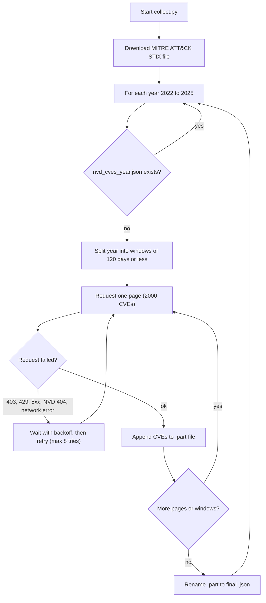

# Stage 02: Data collection

**Status:** In progress (MITRE file downloaded; NVD yearly files not finished yet)

Previous: [Stage 01: Setup](../stage-01-setup/README.md) | Home: [README](../../README.md) | Next: [Stage 03: Data cleaning](../stage-03-data-cleaning/README.md)

## Goal

Download all CVEs published from 2022 to 2025 from the NVD, and the MITRE ATT&CK data.
Save them untouched in `data/raw/`.

## Concepts

- A [CVE](../glossary.md#cve) is a public record of one security flaw. The [NVD](../glossary.md#nvd) adds a [CVSS](../glossary.md#cvss) score to it. It offers these records through a web API.
- [MITRE ATT&CK](../glossary.md#mitre-attck) is a list of attacker techniques. It is published as a [STIX](../glossary.md#stix) JSON file.
- The NVD has a [rate limit](../glossary.md#rate-limit): 5 requests per 30 seconds without a key, 50 with one. The script waits between calls to stay under it.
- The NVD only answers date ranges of up to 120 days. So each year is cut into windows of at most 120 days, and each window is read page by page (2000 CVEs per page).
- Requests sometimes fail for a short time. The script retries with [exponential backoff](../glossary.md#exponential-backoff).
- Each year is first written to a `.part` file and renamed only when the year is complete. A stopped run never leaves a half-finished file that looks finished.

## Flowchart



## What the code does

[src/collect.py](../../src/collect.py), top to bottom:

- **Settings:** years 2022 to 2025, page size 2000, 120-day windows, 8 retries, backoff from 10 s up to 300 s. It reads `NVD_API_KEY` from `.env` or the environment. With a key it waits 0.7 s between calls, without one 6.5 s.
- `backoff_delay(attempt)`: gives the wait time 10, 20, 40, 80, 160, then 300 seconds.
- `get_with_retry(url, params, headers)`: sends the request after a pacing wait. It retries on network errors, HTTP 403 and 429 (rate limit), any 5xx, and HTTP 404 from the NVD endpoint only (NVD sometimes returns a temporary 404). If the server sends a `Retry-After` header, that wait is used. Any other error stops the script. After 8 failed tries it raises an error.
- `date_windows(year)` and `fmt(dt)`: make the 120-day windows and the date text the NVD expects.
- `collect_nvd()`: for each year, writes every CVE (the full NVD record, not a summary) into `nvd_cves_<year>.json.part`, then renames it. It writes page by page so memory stays low. A year whose final file exists is skipped.
- `collect_mitre()`: downloads the ATT&CK Enterprise bundle and saves it as `mitre_enterprise_attack.json`. Skipped if it exists.

Output files in `data/raw/`:

| File | Content |
|---|---|
| `nvd_cves_2022.json` ... `nvd_cves_2025.json` | A JSON list of full NVD CVE objects, one file per year |
| `mitre_enterprise_attack.json` | The ATT&CK STIX bundle |

## How to run

```
cd C:\Users\Preeti\Desktop\cyber-slm
.venv\Scripts\activate
python src\collect.py
```

To start the NVD download again from scratch, delete the files first:

```
del data\raw\nvd_cves_*.json
python src\collect.py
```

## Results

Fill these after you run it. Do not guess.

| Item | Value |
|---|---|
| Ran with an API key? | _fill after run_ |
| CVEs downloaded 2022 | _fill after run_ |
| CVEs downloaded 2023 | _fill after run_ |
| CVEs downloaded 2024 | _fill after run_ |
| CVEs downloaded 2025 | _fill after run_ |
| Total run time | _fill after run_ |

## Common errors and fixes

| Error | Fix |
|---|---|
| Many `HTTP 403` lines | You hit the rate limit. The script waits and retries by itself. Add `NVD_API_KEY` to go faster. |
| `RuntimeError: Gave up after 8 tries` | NVD was down too long. Run the script again. Finished years are skipped. |
| A `.json.part` file is left over | The last run stopped early. Run again. The year restarts and replaces the `.part` file. |
| Stage 03 drops almost every record | Your raw files are from an early version of `collect.py` that saved only a short summary. Delete `data/raw/nvd_cves_*.json` and download again. |
| `HTTP 404` for the MITRE file | The URL changed. It is not retried on purpose. Check `MITRE_URL` in `collect.py`. |
| `ModuleNotFoundError: dotenv` or `requests` | Run `pip install -r requirements-data.txt`. |

## Self-check questions

1. Why are dates split into windows of at most 120 days?
2. What does the script do on an HTTP 503, and how long does it wait the third time?
3. Why write to a `.part` file first?
4. Why keep the full NVD record instead of only the description?
5. Which errors are retried, and which stop the script?
