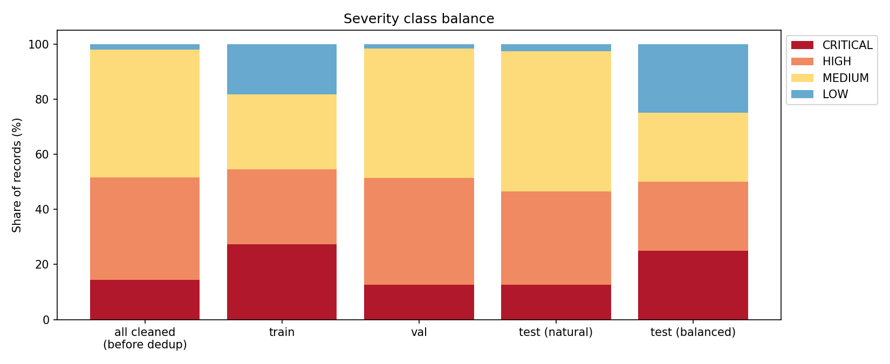
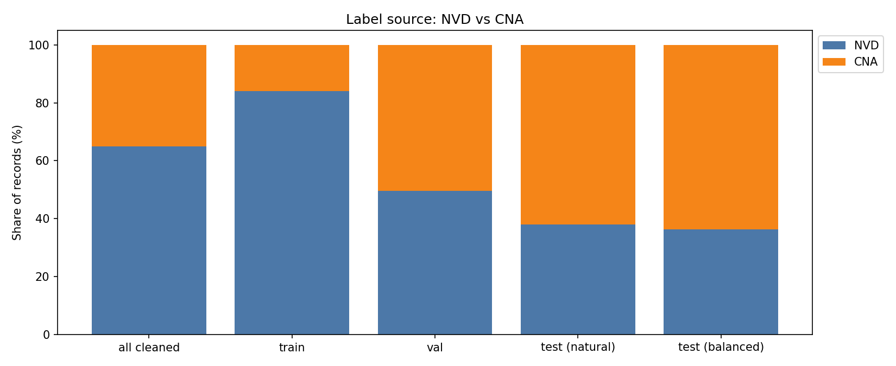
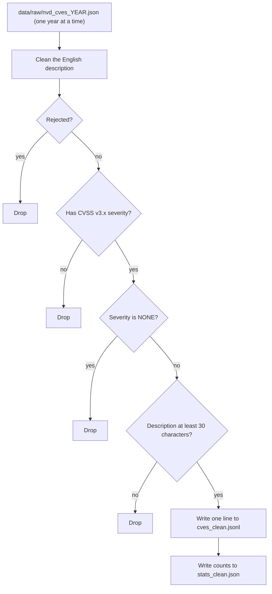
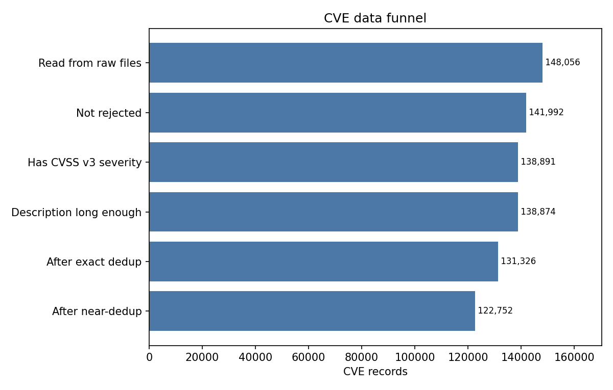

# Stage 03: Data cleaning

**Status:** Done (a re-run is Pending, to apply the NONE filter that I added afterwards)

## Goal

I turn the big raw NVD files into one small clean file, with one line per usable CVE.
I also look at the labels, because they decide what the model can learn.

## Concepts

- A [CVE](../glossary.md#cve) record has many fields. I keep the id, date, English description, [CVSS](../glossary.md#cvss) v3 severity and score, the source of the score, and the [CWE](../glossary.md#cwe) ids.
- A CVE can have several CVSS scores. The NVD's own analysts give the main one. A [CNA](../glossary.md#cna) (often the vendor) may give another. The script prefers the NVD score, falls back to the CNA, and saves which one it used. This is the [label source](../glossary.md#label-source).
- The label is the [base severity](../glossary.md#base-severity): `CRITICAL`, `HIGH`, `MEDIUM` or `LOW`. A score of 0.0 gives `NONE`, which I drop.
- A **rejected** CVE was withdrawn and is not a real flaw, so I remove it.
- The output is [JSONL](../glossary.md#jsonl). The input is read one year at a time, so it fits in 8 GB of memory.

### What the data taught me

- **The classes are very uneven.** LOW is about 2% of the records. A model that never says LOW would still get a high accuracy. That is why I will report [macro-F1](../glossary.md#macro-f1), which gives every class the same weight, and why I build a [class-balanced](../glossary.md#class-balancing) test set in stage 04.
- **The labels come from two kinds of source.** About 65% of the scores come from the NVD and about 35% from CNAs. Different scorers may have different habits. If train and test have different mixes, the model could be judged on a different kind of label than it learned. This is a limitation, and the split is not even: after stage 04, final train is 84.0% NVD labels and the natural test file is 62.1% CNA labels (details in [stage 04](../stage-04-dataset-building/README.md)).



The first bar is all cleaned CVEs before duplicate removal. The other bars are the final splits from stage 04.



## Flowchart



## What the code does

[src/clean_cves.py](../../src/clean_cves.py):

- `clean_text(text)`: removes HTML tags, decodes entities, collapses spaces.
- `english_description(cve)`: returns the first description marked as English.
- `is_rejected(cve, description)`: true if `vulnStatus` is "Rejected" or the text starts with a reject marker.
- `pick_cvss_v3(cve)`: looks at the v3.1 and v3.0 scores. It takes the NVD one if there is one, otherwise the first CNA one. It returns the severity, score, `nvd` or `cna`, and the source id.
- `cwe_ids(cve)`: collects unique real ids like `CWE-79` and skips placeholders such as `NVD-CWE-Other`.
- `main()`: loops over the years, loads one, applies the filters in order, writes each kept record at once, frees the year, prints the counts and writes `data/processed/stats_clean.json`.

Filters, in order:

1. not rejected
2. has a CVSS v3 severity
3. severity is not `NONE`
4. description at least 30 characters (`MIN_DESC_CHARS`)

Each output line has: `id`, `published`, `description`, `cvss_severity`, `cvss_score`, `cvss_source`, `cvss_source_id`, `cwe_ids`.

## How to run

```
python src\clean_cves.py
```

Output: `data/processed/cves_clean.jsonl` and `data/processed/stats_clean.json`. Run it only after stage 02 has finished ([E08](../errors-and-fixes.md#e08)).

## Results and metrics

Source: `data/processed/stats_clean.json`, see [metrics.md](../metrics.md). The step "severity is not NONE" was added after this run, so its count is Pending.



| Step | Records left |
|---|---|
| Read from raw files | 148,056 |
| Not rejected | 141,992 |
| Has CVSS v3 severity | 138,891 |
| Severity is not NONE | Pending |
| Description long enough | 138,874 |

| Severity | Count | Share |
|---|---|---|
| CRITICAL | 19,911 | 14.3% |
| HIGH | 51,750 | 37.3% |
| MEDIUM | 64,383 | 46.4% |
| LOW | 2,828 | 2.0% |
| NONE | 2 | Will be dropped on the next run |

| Label source | Count |
|---|---|
| NVD | 90,275 |
| CNA | 48,599 |

## Errors faced in this stage

- [E02](../errors-and-fixes.md#e02): the first raw files lacked the fields the cleaner needs.
- [E08](../errors-and-fixes.md#e08): I ran the cleaner before the download had finished.

## What I learned

- Read the funnel: the biggest loss was 6,064 rejected CVEs, then 3,101 CVEs with no v3 severity.
- Always look at the class balance before choosing a metric.
- The label source is part of the data. I must state its mix as a limitation.
- A script that quietly accepts empty input hides mistakes. I check each stage's output before the next.

## Navigation

Previous: [Stage 02: Data collection](../stage-02-data-collection/README.md) | [Home](../../README.md) | Next: [Stage 04: Dataset building](../stage-04-dataset-building/README.md)
