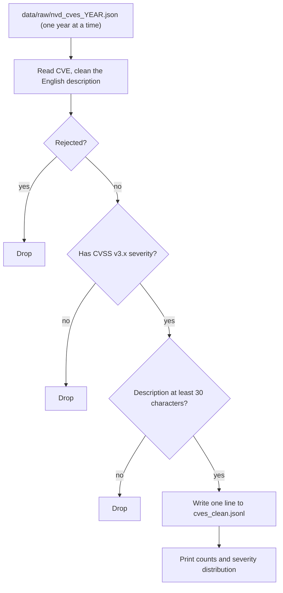

# Stage 03: Data cleaning

**Status:** In progress (ran on missing input; `cves_clean.jsonl` is 0 bytes)

Previous: [Stage 02: Data collection](../stage-02-data-collection/README.md) | Home: [README](../../README.md) | Next: [Stage 04: Dataset building](../stage-04-dataset-building/README.md)

## Goal

Turn the big raw NVD files into one small, clean file with one line per usable CVE.
Drop rejected CVEs, CVEs with no severity, and descriptions that are too short.

## Concepts

- A [CVE](../glossary.md#cve) record holds many fields. We only need the id, date, English description, [CVSS](../glossary.md#cvss) v3 severity and score, and [CWE](../glossary.md#cwe) ids.
- A CVE can have several CVSS scores. NVD's own analysts give the main one (the "primary" source). A [CNA](../glossary.md#cna) may give another. The script prefers NVD and falls back to the CNA, and it saves which one it used (`nvd` or `cna`).
- Only CVSS v3.x is used (3.1 first, then 3.0). The label is the [base severity](../glossary.md#base-severity).
- A **rejected** CVE was withdrawn. It is not a real flaw, so it is removed.
- Some descriptions contain HTML tags or entities like `&amp;`. The script strips them.
- The output is [JSONL](../glossary.md#jsonl). The input is read one year at a time, so memory stays low on an 8 GB laptop.

## Flowchart



## What the code does

[src/clean_cves.py](../../src/clean_cves.py):

- `clean_text(text)`: removes HTML tags, decodes entities, collapses spaces.
- `english_description(cve)`: returns the first description marked as English.
- `is_rejected(cve, description)`: true if `vulnStatus` is "Rejected" or the text starts with `** REJECT **` or `Rejected reason:`.
- `pick_cvss_v3(cve)`: looks at the v3.1 and v3.0 scores. It takes the one from `nvd@nist.gov` if there is one, otherwise the first CNA score. It returns severity, score, `nvd` or `cna`, and the source id. It returns nothing if there is no v3 severity.
- `cwe_ids(cve)`: collects unique ids like `CWE-79`. Placeholders such as `NVD-CWE-Other` are skipped.
- `main()`: loops over 2022 to 2025, loads one year, applies the filters in this order, writes each kept record at once, frees the year, and prints the counts.

Filter order (the count after each step is printed):

1. not rejected
2. has a CVSS v3 severity
3. description at least 30 characters (`MIN_DESC_CHARS`)

Each output line has: `id`, `published`, `description`, `cvss_severity`, `cvss_score`, `cvss_source`, `cvss_source_id`, `cwe_ids`.

## How to run

```
cd C:\Users\Preeti\Desktop\cyber-slm
.venv\Scripts\activate
python src\clean_cves.py
```

Output: `data/processed/cves_clean.jsonl`.

## Results

Current state: `data/processed/cves_clean.jsonl` is 0 bytes, because `data/raw/` has no finished NVD files yet (see stage 02). No counts exist. Fill these after a run on real data. Do not guess.

| Step | Records left |
|---|---|
| Read from raw files | _fill after run_ |
| After removing rejected | _fill after run_ |
| After requiring CVSS v3 severity | _fill after run_ |
| After removing short descriptions | _fill after run_ |

| Severity | Count | Share |
|---|---|---|
| CRITICAL | _fill after run_ | _fill after run_ |
| HIGH | _fill after run_ | _fill after run_ |
| MEDIUM | _fill after run_ | _fill after run_ |
| LOW | _fill after run_ | _fill after run_ |

Score source: NVD _fill after run_ / CNA _fill after run_

## Common errors and fixes

| Error | Fix |
|---|---|
| `nvd_cves_YEAR.json missing, skipping` | Run stage 02 first. |
| Almost nothing survives the filters | The raw files are from an early version of `collect.py` (summary only). Delete them and run stage 02 again. |
| `json.decoder.JSONDecodeError` | A raw file is broken (an interrupted download). Delete that year's file and run stage 02 again. |
| `MemoryError` | Close other programs. The script loads one raw year at a time, so a single year must fit in memory. |

## Self-check questions

1. Why prefer the NVD score over the CNA score, and why store which one was used?
2. Why filter rejected CVEs before looking at severity?
3. Why does the script load one year at a time?
4. What does `cwe_ids` do with `NVD-CWE-Other`, and why?
5. Why remove very short descriptions?
