# Stage 04: Dataset building

**Status:** In progress (ATT&CK part done and measured; severity part has not run on real data yet)

Previous: [Stage 03: Data cleaning](../stage-03-data-cleaning/README.md) | Home: [README](../../README.md) | Next: [Stage 05: Smoke test](../stage-05-smoke-test/README.md)

## Goal

Build train, validation and test files in [chat format](../glossary.md#chat-format) for two tasks: CVE severity, and ATT&CK technique naming.
Make the splits fair: no repeated text and no [leakage](../glossary.md#data-leakage) from train into test.

## Concepts

- **Two tasks.** Severity: given a CVE description, answer `CRITICAL`, `HIGH`, `MEDIUM` or `LOW`. ATT&CK: given a description of attacker behaviour, answer the technique, like `T1566.001 Spearphishing Attachment`.
- **Exact duplicates:** the same text twice. Found by comparing the normalised text (lowercase, one space between words).
- **Near-duplicates:** almost the same text. Found with [MinHash](../glossary.md#minhash) and [LSH](../glossary.md#lsh) on word 3-[shingles](../glossary.md#shingle). Two texts with [Jaccard similarity](../glossary.md#jaccard-similarity) of about 0.85 or more count as near-duplicates. One is kept.
- **Date split for CVEs:** train is 2022-01-01 to 2024-09-30, validation is 2024-10-01 to 2024-12-31, test is 2025. The model is tested on newer CVEs than it learned from. See [data split](../glossary.md#data-split).
- **Class balancing:** train has at most a set number of examples per severity ([class balancing](../glossary.md#class-balancing)). Validation and test keep the natural mix, capped at about 1000 each.
- **Group split for ATT&CK:** every group or software goes to only one split (about 80/10/10). Otherwise the model could memorise how one group's text is written.
- **ATT&CK data comes from "uses" relationships:** (a [group](../glossary.md#intrusion-set), malware or tool) uses (a [technique](../glossary.md#technique--sub-technique)), with a text that describes how. Citations and link addresses are removed from that text.

## Flowchart

```mermaid
flowchart TD
    subgraph CVE["Severity dataset (build_cve_dataset.py)"]
        A["cves_clean.jsonl"] --> B["Normalise text, drop exact duplicates"]
        B --> C["MinHash LSH near-duplicate removal"]
        C --> D["Split by published date"]
        D --> E["Remove val and test records similar to train"]
        E --> F["Train: cap per severity. Val and test: natural mix, capped"]
        F --> G["severity_train, severity_val, severity_test .jsonl"]
        F --> H["stats_cve.json"]
    end
    subgraph ATT["ATT&CK dataset (build_attack_dataset.py)"]
        I["mitre_enterprise_attack.json"] --> J["Keep uses: group, malware or tool to technique, with description"]
        J --> K["Clean text, drop duplicates"]
        K --> L["Split by source about 80/10/10"]
        L --> M["attack_train, attack_val, attack_test .jsonl"]
        L --> N["stats_attack.json"]
    end
```



## What the code does

[src/build_cve_dataset.py](../../src/build_cve_dataset.py):

- Loads only id, date, text and label from `cves_clean.jsonl`, and sorts oldest first (so the oldest copy of a duplicate is kept, which favours train).
- Step 1: exact duplicates by hash of the normalised text.
- Step 2: near-duplicates with a MinHash LSH index (`minhash_of` builds the fingerprint).
- Step 3: date split into train, val and test.
- Step 4: checks val and test against an index of train. Step 2 already removes cross-split near-duplicates, so this normally removes 0 and works as a safety check. `stats_cve.json` reports the number.
- Step 5: samples train per severity up to `train_cap_per_class`, and takes a random sample of `eval_cap` for val and test. Writes the files with `to_chat`.
- Settings are in [configs/dataset.json](../../configs/dataset.json). Missing keys fall back to defaults in the script. The train cap of 2000 is a starting guess, not a tuned value.

[src/build_attack_dataset.py](../../src/build_attack_dataset.py):

- Reads the STIX bundle and skips revoked and deprecated objects.
- Keeps `uses` relationships from `intrusion-set`, `malware` or `tool` to `attack-pattern` that have a description.
- `clean_text` removes `(Citation: ...)`, turns `[text](url)` into `text`, and removes `<code>` tags.
- Removes duplicates (same text and same technique).
- `split_sources` gives whole sources to splits, largest first, each to the split furthest below its target. A few large groups can still move the real ratio away from 80/10/10.
- Writes `stats_attack.json`, which also counts how many val and test techniques never appear in train.

Output files in `data/processed/`:

| File | Content |
|---|---|
| `severity_train.jsonl`, `severity_val.jsonl`, `severity_test.jsonl` | Severity examples, messages only. Test keeps the natural class mix (capped by `eval_cap`). |
| `severity_test_balanced.jsonl` | Up to `balanced_test_per_class` (150) test examples per severity, or all of a class if it has fewer. Same duplicate and leakage rules as the test file. |
| `attack_train.jsonl`, `attack_val.jsonl`, `attack_test.jsonl` | ATT&CK examples, messages only |
| `stats_cve.json`, `stats_attack.json` | Counts after every step, class and split sizes |

## How to run

Run stages 02 and 03 first.

```
cd C:\Users\Preeti\Desktop\cyber-slm
.venv\Scripts\activate
python src\build_cve_dataset.py
python src\build_attack_dataset.py
```

The two scripts write separate stats files, so the order does not matter.

## Results

Numbers below come from `data/processed/stats.json` (written by the ATT&CK script before the stats files were separated). I also counted the lines of the output files, and they match.

### ATT&CK dataset (done)

| Step | Count |
|---|---|
| Relationships in the STIX file (all types) | 21,822 |
| "uses" relationships that are not revoked or deprecated | 18,975 |
| ...from a group, malware or tool to a technique | 16,423 |
| ...with a description | 16,423 |
| After cleaning (text not empty) | 16,423 |
| After removing duplicates | 16,423 |

| Split | Examples | Share | Groups or software | Different techniques | Techniques not in train |
|---|---|---|---|---|---|
| train | 13,139 | 80.0% | 594 | 592 | 0 |
| val | 1,642 | 10.0% | 211 | 286 | 9 |
| test | 1,642 | 10.0% | 211 | 293 | 9 |

How to read this:

- Cleaning and duplicate removal changed no counts in this run. Every kept relationship already had a description, and no two shared the same text and technique.
- The split came out at 80/10/10.
- Val and test each hold 9 techniques the model never sees in training. Those can only be answered by generalising.
- The script is built so each group or software lands in one split only. I have not checked that on the output files.

The first line of `attack_train.jsonl`:

- user: "As part of the data reconnaissance phase, Proxysvc grabs the system time to send back to the control server."
- assistant: `T1124 System Time Discovery`

### Severity dataset (not done)

The severity script ran on an empty input. `data/processed/cves_clean.jsonl` is 0 bytes, and so are the three `severity_*.jsonl` files. Every severity count in `stats.json` is 0.

The cause is upstream. `data/raw/` has no finished NVD files yet, only a 0-byte `nvd_cves_2022.json.part`. Finish stage 02 and stage 03, then run `build_cve_dataset.py` again.

| Item | Value |
|---|---|
| CVE records loaded | _fill after run_ |
| After exact dedup | _fill after run_ |
| After near-dedup | _fill after run_ |
| Train / val / test size before sampling | _fill after run_ |
| Removed by the train-leak check | _fill after run_ |
| Final severity train / val / test | _fill after run_ |
| Severity mix in final train | _fill after run_ |
| Severity mix in final val and test | _fill after run_ |

### Stats file names

Your current `stats.json` is from before the stats files were split. The next run of each script writes `stats_cve.json` and `stats_attack.json`. You can delete the old `stats.json` after that.

## Common errors and fixes

| Error | Fix |
|---|---|
| `ModuleNotFoundError: No module named 'datasketch'` | `pip install -r requirements-data.txt` |
| `FileNotFoundError` for `cves_clean.jsonl` | Run stage 03 first. |
| Val or test has 0 records | Your data has no CVEs in those dates, or the filters removed them. Check `stats_cve.json`. |
| ATT&CK split is far from 80/10/10 | A few groups have many examples. Check the per-split counts in `stats_attack.json`. |
| `KeyError: 'objects'` in the ATT&CK script | The raw file is not a STIX bundle. Download it again with stage 02. |

## Self-check questions

1. Why split CVEs by date instead of randomly?
2. What is a near-duplicate, and why remove them across train and test?
3. Why is train balanced but val and test left natural?
4. Why split ATT&CK data by group instead of by row?
5. Why is step 4 usually a no-op, and why keep it?
