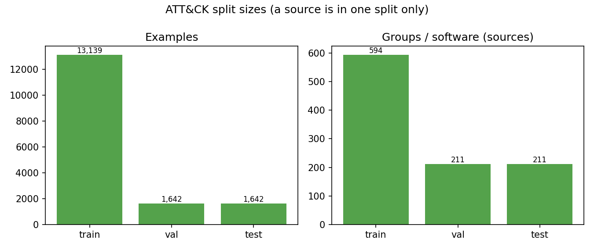
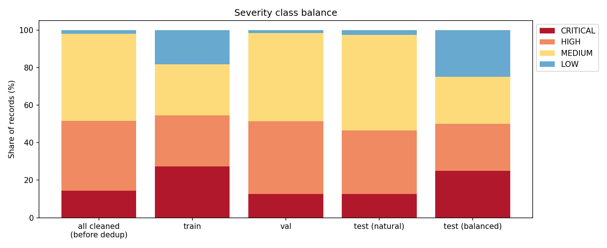
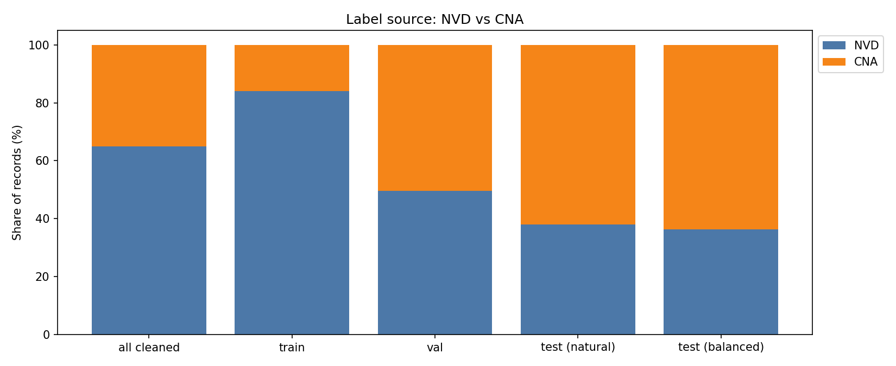

# Stage 04: Dataset building

**Status:** Done. Both datasets are built and measured.

## Goal

I build train, validation and test files in [chat format](../glossary.md#chat-format) for two tasks: CVE severity, and ATT&CK technique naming.
I make the splits fair, so no text leaks from train into test.

## Concepts

- **Two tasks.** Severity: given a CVE description, answer `CRITICAL`, `HIGH`, `MEDIUM` or `LOW`. ATT&CK: given a description of attacker behaviour, answer the technique, like `T1566.001 Spearphishing Attachment`.
- **Why the splits matter.** [Data leakage](../glossary.md#data-leakage) means the model has seen the test answer in training. Scores then look better than they are.
  - **CVEs are split by time.** Train is 2022-01-01 to 2024-09-30, validation is 2024-10-01 to 2024-12-31 and test is 2025. The model is tested on newer CVEs than it learned from, like real use.
  - **ATT&CK is split by group or software.** One group never appears in two splits, so the model cannot just remember how one group's text is written.
- **Exact duplicates** are the same text twice. I find them with a hash of the normalised text.
- **Near-duplicates** matter for CVEs, because many descriptions are written from templates (the same sentence with a different product or version). If a near-copy of a test example is in train, the test score is too high. I find them with [MinHash](../glossary.md#minhash) and [LSH](../glossary.md#lsh) on word 3-[shingles](../glossary.md#shingle), with a [Jaccard similarity](../glossary.md#jaccard-similarity) threshold of 0.85. It removed 7,546 exact and 8,574 near-duplicates from the CVEs (see the results below).
- **Class balance.** The classes are uneven (LOW is about 2%, see [stage 03](../stage-03-data-cleaning/README.md)). So:
  - train has a cap per class (2000), so the model sees every class often;
  - validation and the main test file keep the natural mix, capped at 1000;
  - `severity_test_balanced.jsonl` has up to 150 per class (all of a class if it has fewer), with the same duplicate and leakage rules. It shows how well the model does on rare classes.
  - I will report [macro-F1](../glossary.md#macro-f1) as well as accuracy.
- **Label source.** I count how many labels in each split come from the NVD and how many from a CNA ([label source](../glossary.md#label-source)). If the mix differs a lot between train and test, that is a limitation to state. It does differ: see the results below.
- **ATT&CK data** comes from "uses" relationships: a [group](../glossary.md#intrusion-set), malware or tool uses a [technique](../glossary.md#technique--sub-technique), with a text that says how. Citations and link addresses are removed from the text.

## Flowchart

```mermaid
flowchart TD
    subgraph CVE["Severity dataset (build_cve_dataset.py)"]
        A["cves_clean.jsonl"] --> A2["Keep LOW, MEDIUM, HIGH, CRITICAL"]
        A2 --> B["Normalise text, drop exact duplicates"]
        B --> C["MinHash LSH near-duplicate removal"]
        C --> D["Split by published date"]
        D --> E["Remove val and test records similar to train"]
        E --> F["Train: cap per class. Val and test: natural mix, capped"]
        E --> F2["Balanced test: up to 150 per class"]
        F --> G["severity_train, val, test .jsonl"]
        F2 --> G2["severity_test_balanced.jsonl"]
        F --> H["stats_cve.json"]
    end
    subgraph ATT["ATT&CK dataset (build_attack_dataset.py)"]
        I["mitre_enterprise_attack.json"] --> J["Keep uses: group, malware or tool to technique, with description"]
        J --> K["Clean text, drop duplicates"]
        K --> L["Split by source, about 80/10/10"]
        L --> M["attack_train, val, test .jsonl"]
        L --> N["stats_attack.json"]
    end
```



## What the code does

[src/build_cve_dataset.py](../../src/build_cve_dataset.py):

- Loads id, date, text, label and score source from `cves_clean.jsonl`, sorted oldest first (so the oldest copy of a duplicate is kept, which favours train).
- Drops any record whose severity is not LOW, MEDIUM, HIGH or CRITICAL.
- Step 1: exact duplicates. Step 2: near-duplicates with a MinHash LSH index (`minhash_of` builds the fingerprint).
- Step 3: date split. Step 4: checks val and test against an index of train. Step 2 already removes cross-split near-duplicates, so this usually removes 0. It stays as a safety check.
- Step 5: train sampling per class; random samples for val and test; the balanced test file.
- Writes `stats_cve.json`: after every step the count, the class counts and the NVD/CNA counts. The `3_split_*`, `4_no_train_leak_*` and `5_final_*` entries are the per-split numbers.
- All settings are in [configs/dataset.json](../../configs/dataset.json): `train_cap_per_class`, `eval_cap`, `balanced_test_per_class`, the threshold, the seed and the split dates.

[src/build_attack_dataset.py](../../src/build_attack_dataset.py):

- Reads the STIX bundle and skips revoked and deprecated objects.
- Keeps `uses` relationships from `intrusion-set`, `malware` or `tool` to `attack-pattern` that have a description.
- `clean_text` removes `(Citation: ...)`, turns a markdown link into its link text, and removes `<code>` tags.
- Removes duplicates (same text and same technique).
- `split_sources` gives whole sources to splits, largest first, each to the split furthest below its target.
- Writes `stats_attack.json`.

Output files in `data/processed/`:

| File | Content |
|---|---|
| `severity_train.jsonl`, `severity_val.jsonl`, `severity_test.jsonl` | Severity examples, messages only |
| `severity_test_balanced.jsonl` | Up to 150 test examples per class |
| `attack_train.jsonl`, `attack_val.jsonl`, `attack_test.jsonl` | ATT&CK examples, messages only |
| `stats_cve.json`, `stats_attack.json` | Counts after every step |

## How to run

```
python src\build_cve_dataset.py
python src\build_attack_dataset.py
```

Run stages 02 and 03 first. The two scripts write separate stats files, so their order does not matter ([E11](../errors-and-fixes.md#e11)).

## Results and metrics

Source: `data/processed/stats_attack.json` and `data/processed/stats_cve.json`, see [metrics.md](../metrics.md).

### ATT&CK dataset (measured)

| Step | Count |
|---|---|
| Relationships in the STIX file | 21,822 |
| Active "uses" relationships | 18,975 |
| Group, malware or tool to technique | 16,423 |
| With a description | 16,423 |
| After cleaning | 16,423 |
| After removing duplicates | 16,423 |

| Split | Examples | Sources | Different techniques | Techniques not in train |
|---|---|---|---|---|
| train | 13,139 | 594 | 592 | 0 |
| val | 1,642 | 211 | 286 | 9 |
| test | 1,642 | 211 | 293 | 9 |



Cleaning and duplicate removal changed no counts here. The split is close to 80/10/10. Val and test each hold 9 techniques the model never sees in training.

### CVE severity dataset (measured)

Source: `data/processed/stats_cve.json`. The builder ran on the full cleaned data (the 138,874 records from stage 03).

| Step | Records | CRITICAL | HIGH | MEDIUM | LOW |
|---|---|---|---|---|---|
| Loaded | 138,874 | 19,911 | 51,750 | 64,383 | 2,828 |
| Only LOW, MEDIUM, HIGH, CRITICAL (2 NONE dropped) | 138,872 | 19,911 | 51,750 | 64,383 | 2,828 |
| After exact dedup | 131,326 | 19,539 | 48,150 | 60,919 | 2,718 |
| After near-dedup | 122,752 | 18,517 | 44,738 | 56,949 | 2,548 |

Exact dedup removed 7,546 records and near-dedup removed 8,574 more.

| Split | Before sampling | After sampling | CRITICAL | HIGH | MEDIUM | LOW |
|---|---|---|---|---|---|---|
| train | 72,517 | 7,343 | 2,000 | 2,000 | 2,000 | 1,343 |
| val | 9,378 | 1,000 | 127 | 386 | 470 | 17 |
| test (natural) | 40,857 | 1,000 | 127 | 337 | 510 | 26 |
| test (balanced) | from the 40,857 | 600 | 150 | 150 | 150 | 150 |

The train-leak check removed 0 records from val and 0 from test. As expected, step 2 had already removed cross-split near-duplicates. LOW has only 1,343 train examples (all that exist, below the cap of 2000). The natural val and test files hold just 17 and 26 LOW examples, so a LOW score on them is very noisy. That is why the balanced test file exists.

Label source (who gave the CVSS score), before and after sampling:

| Split | NVD before sampling | CNA before sampling | NVD after sampling | CNA after sampling |
|---|---|---|---|---|
| train | 61,647 | 10,870 | 6,170 | 1,173 |
| val | 4,634 | 4,744 | 496 | 504 |
| test (natural) | 15,634 | 25,223 | 379 | 621 |
| test (balanced) | | | 218 | 382 |





**What this shows.** The label source changes a lot over time. In final train, 84.0% of labels are NVD scores. In the natural test file, 62.1% are CNA scores. The model is trained mostly on NVD-style labels and tested mostly on CNA-style labels. I have not checked why the mix shifts. A drop in test score could come from this shift and not from the model. I will report the NVD and CNA parts of the test set separately when I evaluate.

## Errors faced in this stage

- [E07](../errors-and-fixes.md#e07): `datasketch` was not installed.
- [E11](../errors-and-fixes.md#e11): the second script overwrote the first script's stats file.

## What I learned

- Where I cut the data decides whether the test score means anything.
- Template-like text makes near-duplicates a real risk for CVEs.
- A stats file per script avoids silent overwrites.
- A script that works on empty input still produces files. I check the sizes of the outputs.
- The stats files showed me a problem I did not plan for: train labels are mostly NVD scores and test labels are mostly CNA scores.
- The natural val and test files have very few LOW examples (17 and 26), so a balanced test file is needed.

## Navigation

Previous: [Stage 03: Data cleaning](../stage-03-data-cleaning/README.md) | [Home](../../README.md) | Next: [Stage 05: Smoke test](../stage-05-smoke-test/README.md)
