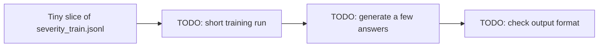

# Stage 05: Smoke test

**Status:** Todo

Previous: [Stage 04: Dataset building](../stage-04-dataset-building/README.md) | Home: [README](../../README.md) | Next: [Stage 06: QLoRA training](../stage-06-qlora-training/README.md)

## Goal

Run a very small training job on a few dozen examples to check the whole pipeline works from data to model output.
Find setup and memory problems before the long run.

## Concepts

- A [smoke test](../glossary.md#smoke-test) checks that things run. It does not judge model quality.
- TODO: explain what to look for (loss goes down, no crash, the model produces output).

## Flowchart

## What the code does

TODO: no code yet.

## How to run

TODO

## Results

_fill after run_

## Common errors and fixes

TODO

## Self-check questions

TODO (3 to 5 questions)
