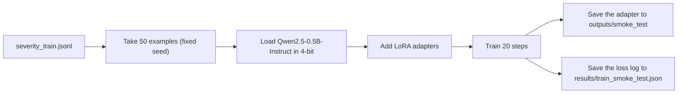

# Stage 05: Smoke test

**Status:** In progress. The code and config are written. I have not run them yet.

## Goal

I run a very small training job (50 examples, 20 steps) to check that the whole path works: data, model loading, training and saving an adapter.
It tells me nothing about model quality. It only finds setup problems before the long run.

## Concepts

- A [smoke test](../glossary.md#smoke-test) checks that things run, not that they are good.
- [Fine-tuning](../glossary.md#fine-tuning) with [QLoRA](../glossary.md#qlora): the base model is stored in 4 bits ([quantization](../glossary.md#quantization)) and I train only small [LoRA](../glossary.md#lora) adapters on top. That is how a 0.5B model trains on a free Colab GPU.
- Loss only on the answer: the training example has a prompt (system and user messages) and a completion (the assistant answer). The model is graded only on the completion.
- This needs a CUDA GPU, so it runs on Google Colab, not on my laptop ([E09](../errors-and-fixes.md#e09)).

## Flowchart



## What the code does

- [configs/smoke_test.yaml](../../configs/smoke_test.yaml): model `Qwen/Qwen2.5-0.5B-Instruct`, 50 samples, 20 steps, max length 512, batch size 2 with 4 gradient accumulation steps (8 examples per step), learning rate 0.0002, LoRA rank 16 and alpha 32, seed 42.
- [src/train.py](../../src/train.py): reads a YAML config, loads the chat JSONL and turns each example into prompt and completion. It loads the model in 4-bit NF4, adds LoRA with PEFT, and trains with TRL's `SFTTrainer` with `completion_only_loss=True`. It logs to Weights and Biases only if `WANDB_API_KEY` is set. It saves the adapter and a loss log in `results/train_<name>.json`. Every training argument has a comment in the file.
- [notebooks/run_on_colab.ipynb](../../notebooks/run_on_colab.ipynb): clones the repo, installs `requirements-train.txt`, reads the tokens from Colab Secrets and runs the smoke test.

## How to run

On Google Colab with a GPU runtime, open the notebook and run all cells. Or, in a Colab terminal:

```
pip install -r requirements-train.txt
python src/train.py --config configs/smoke_test.yaml
```

The Colab notebook clones the repo from GitHub, so `data/processed/severity_train.jsonl` (7,343 examples, see [metrics](../metrics.md)) must be committed and pushed first. `train.py` stops with a clear message if the file has no examples.

## Results and metrics

| Item | Value |
|---|---|
| Training loss, first and last step | Pending |
| Run time | Pending |
| GPU used | Pending |
| Adapter saved | Pending |

The loss chart `docs/images/training_loss.png` is created by `python src/make_figures.py` after a training run.

## Errors faced in this stage

- [E09](../errors-and-fixes.md#e09): the training packages are not installed on my laptop, which has no GPU.
- [E17](../errors-and-fixes.md#e17): bf16 was chosen on a T4, which only supports fp16. `train.py` now picks the precision from the GPU's compute capability and prints it at the start.
- [E18](../errors-and-fixes.md#e18): trainable parameters were still bfloat16 in an fp16 run. `train.py` now prints the dtypes, casts the trainable parameters to float32 and asserts none is 16-bit.
- [E19](../errors-and-fixes.md#e19): the time estimate ignored `max_steps`. It now reads the run's real step total.

## What I learned

- Plan where each stage runs before writing code.
- A smoke test has to be small and fixed (seed, sample count), so a failure points to the setup and not to randomness.

## Navigation

Previous: [Stage 04: Dataset building](../stage-04-dataset-building/README.md) | [Home](../../README.md) | Next: [Stage 06: QLoRA training](../stage-06-qlora-training/README.md)
