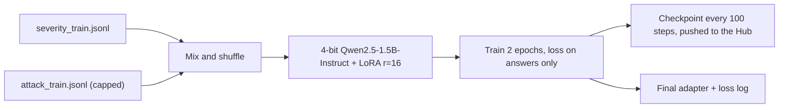

# Stage 06: QLoRA training

**Status:** In progress. The config and script are written. I have not run the main training yet.

## Goal

I fine-tune `Qwen/Qwen2.5-1.5B-Instruct` on the severity data mixed with the ATT&CK data, for 2 epochs, and save checkpoints to a Hugging Face Hub repo.
The two tasks are balanced with a cap on the ATT&CK examples.

## Concepts

- [QLoRA](../glossary.md#qlora): a 4-bit base model plus small [LoRA](../glossary.md#lora) adapters. Only the adapters are trained and saved.
- LoRA rank (`r`) is the adapter size. Alpha scales the adapter output. A bigger rank can learn more and needs more memory. Stage 08 tests ranks 8, 16 and 64.
- An [epoch](../glossary.md#epoch) is one full pass over the training data.
- Mixing two tasks: the ATT&CK file is much larger than the severity file can be, so `max_attack_samples` caps it. Then neither task drowns the other.
- Checkpoints every N steps, pushed to the Hub, mean a Colab disconnect does not lose the whole run.
- [Overfitting](../glossary.md#overfitting): watch the validation results, not only the training loss.

## Flowchart



## What the code does

- [configs/qlora_main.yaml](../../configs/qlora_main.yaml): model `Qwen/Qwen2.5-1.5B-Instruct`; LoRA r 16, alpha 32, dropout 0.05; learning rate 0.0002; 2 epochs; max length 768; batch 4 with 4 accumulation steps; 30 warmup steps; up to 4000 ATT&CK examples; a checkpoint every 100 steps (the newest 3 kept locally); `push_to_hub: true`. The line `hub_model_id` holds a placeholder that I must change to my own repo.
- [src/train.py](../../src/train.py): the same script as the smoke test. `build_dataset()` loads the severity file, adds the ATT&CK file if `attack_file` is set, caps each, mixes and shuffles with a fixed seed. Everything comes from the YAML. It stops early if `push_to_hub` is on but `HF_TOKEN` or `hub_model_id` is missing.

## How to run

On Colab, after the smoke test works:

```
python src/train.py --config configs/qlora_main.yaml
```

`HF_TOKEN` must be set (Colab Secrets). Copy `results/train_qlora_main.json` back into the repo afterwards, then run `python src/make_figures.py`.

## Results and metrics

| Item | Value |
|---|---|
| Final training loss | Pending |
| Training time | Pending |
| GPU | Pending |
| Examples used (severity / ATT&CK) | Pending |
| Checkpoints on the Hub | Pending |

## Errors faced in this stage

- [E09](../errors-and-fixes.md#e09): the training stack is for Colab, not the laptop.
- [E17](../errors-and-fixes.md#e17): the T4 has no bf16 support. Precision now follows the GPU (fp16 below compute capability 8, bf16 from 8).

## What I learned

- QLoRA makes a 1.5B model trainable on a small GPU because only the adapters are trained.
- Settings in a YAML file make a run repeatable and easy to compare in ablations.
- The balance between tasks is a setting, not an accident.

## Navigation

Previous: [Stage 05: Smoke test](../stage-05-smoke-test/README.md) | [Home](../../README.md) | Next: [Stage 07: Evaluation](../stage-07-evaluation/README.md)
