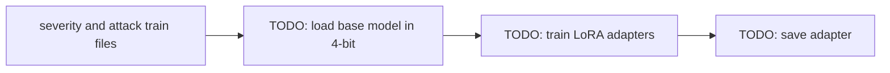

# Stage 06: QLoRA training

**Status:** Todo

Previous: [Stage 05: Smoke test](../stage-05-smoke-test/README.md) | Home: [README](../../README.md) | Next: [Stage 07: Evaluation](../stage-07-evaluation/README.md)

## Goal

Fine-tune a small language model on the severity and ATT&CK datasets with QLoRA.
The base model and settings are not chosen yet.

## Concepts

- [Fine-tuning](../glossary.md#fine-tuning), [LoRA](../glossary.md#lora), [QLoRA](../glossary.md#qlora) and [quantization](../glossary.md#quantization).
- [SLM](../glossary.md#slm): why a small model.
- [Overfitting](../glossary.md#overfitting).
- TODO: explain each in beginner words with the final settings.

## Flowchart

## What the code does

TODO: no code yet.

## How to run

TODO

## Results

_fill after run_

## Common errors and fixes

TODO

## Self-check questions

TODO (3 to 5 questions)
