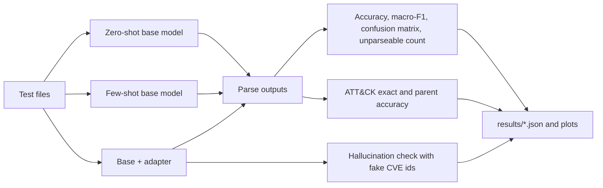

# Stage 07: Evaluation

**Status:** In progress. `src/evaluate.py` is written. I have not run it on a model yet.

## Goal

I measure the base model and the fine-tuned model on the test files, and compare them.
Fine-tuning only counts if it beats the [baseline](../glossary.md#baseline).

## Concepts

- Three modes: **zero-shot** (just the question), **few-shot** (a few worked examples from the train files in the prompt) and **fine-tuned** (base model plus the adapter).
- **Accuracy** is the share of right answers. With uneven classes it can hide problems (LOW is about 2% of the data, see [stage 03](../stage-03-data-cleaning/README.md)).
- [Macro-F1](../glossary.md#macro-f1) averages the F1 score of each class, so a rare class counts as much as a common one.
- A [confusion matrix](../glossary.md#confusion-matrix) shows which class is mistaken for which.
- For ATT&CK I report exact-match accuracy on the technique id and parent-technique accuracy (`T1566` for `T1566.001`).
- Outputs that I cannot read as a label count as wrong and are counted separately as "unparseable".
- The [hallucination](../glossary.md#hallucination) check asks for the severity of CVE ids that do not exist (years 2090 to 2099). A good model says it does not know.
- I will run the severity test twice: on the natural test file and on `severity_test_balanced.jsonl`.
- **Every severity metric is reported three times:** on all samples, only on samples whose label came from the NVD, and only on samples whose label came from a CNA. Train is mostly NVD labels and the natural test file is mostly CNA labels ([stage 04](../stage-04-dataset-building/README.md)), so one number would mix two kinds of label. Each group also has its own sample count, so a tiny group is easy to spot.

## Flowchart



## What the code does

[src/evaluate.py](../../src/evaluate.py):

- `load_model()`: loads the base model in 4-bit and attaches the adapter in fine-tuned mode.
- `pick_shots()` and `build_messages()`: build few-shot prompts from the train files.
- `generate()`: greedy generation in batches with the model's chat template.
- `parse_severity()` and `parse_technique()`: take the first severity word or technique id in the output, ignoring case.
- `severity_metrics()`: accuracy, accuracy on parseable outputs, macro-F1, per-class scores, the confusion matrix and the sample count `n`.
- `severity_by_source()`: runs `severity_metrics()` for all samples, for `cvss_source = nvd` and for `cvss_source = cna`. The result JSON keeps the all-samples numbers under `severity` and the three groups under `severity_by_source`. An empty group gives `n = 0` and no scores. If the test file has no source information, the JSON says so in a `note`.
- The source is read from a separate `meta` field of each test line (`{"id": ..., "cvss_source": ...}`). The chat `messages` are unchanged, and `train.py` ignores `meta`. The predictions file also stores `cvss_source` per example.
- `attack_metrics()`: exact-match and parent-technique accuracy, and how many predicted ids do not exist in my data.
- `hallucination_check()`: asks about made-up CVE ids and counts how often the model gives a severity anyway.
- Saves `results/<name>.json`, a predictions file and the plots.

## How to run

On Colab:

```
python src/evaluate.py --mode zero-shot --model Qwen/Qwen2.5-1.5B-Instruct
python src/evaluate.py --mode few-shot --model Qwen/Qwen2.5-1.5B-Instruct --few-shot-k 4
python src/evaluate.py --mode fine-tuned --model Qwen/Qwen2.5-1.5B-Instruct --adapter outputs/qlora_main
```

To use the balanced test file: add `--severity-test data/processed/severity_test_balanced.jsonl --name <new name>`. For a first check without severity data, add `--task attack`.

## Results and metrics

| Metric | Zero-shot | Few-shot | Fine-tuned |
|---|---|---|---|
| Severity accuracy | Pending | Pending | Pending |
| Severity macro-F1 | Pending | Pending | Pending |
| Severity unparseable | Pending | Pending | Pending |
| Severity accuracy, NVD labels only (n = Pending) | Pending | Pending | Pending |
| Severity macro-F1, NVD labels only | Pending | Pending | Pending |
| Severity accuracy, CNA labels only (n = Pending) | Pending | Pending | Pending |
| Severity macro-F1, CNA labels only | Pending | Pending | Pending |
| ATT&CK exact match | Pending | Pending | Pending |
| ATT&CK parent-technique | Pending | Pending | Pending |
| ATT&CK unparseable | Pending | Pending | Pending |
| Fake CVE ids answered with a severity | Pending | Pending | Pending |

The chart `docs/images/evaluation_scores.png` is created by `python src/make_figures.py` after evaluation runs exist.

## Errors faced in this stage

- [E09](../errors-and-fixes.md#e09): the evaluation script also needs the Colab packages.

## What I learned

- Pick the metric before looking at results, and choose one that fits uneven classes.
- Count what I cannot parse. Hiding it would flatter the model.
- A baseline is the only way to know if fine-tuning helped.

## Navigation

Previous: [Stage 06: QLoRA training](../stage-06-qlora-training/README.md) | [Home](../../README.md) | Next: [Stage 08: Ablations](../stage-08-ablations/README.md)
