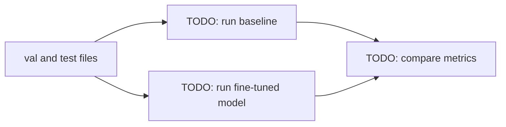

# Stage 07: Evaluation

**Status:** Todo

Previous: [Stage 06: QLoRA training](../stage-06-qlora-training/README.md) | Home: [README](../../README.md) | Next: [Stage 08: Ablations](../stage-08-ablations/README.md)

## Goal

Measure the fine-tuned model on the validation and test files and compare it with a [baseline](../glossary.md#baseline).
The metrics are not chosen yet.

## Concepts

- [Baseline](../glossary.md#baseline), [data split](../glossary.md#data-split), [hallucination](../glossary.md#hallucination).
- TODO: choose and explain metrics for both tasks.

## Flowchart

## What the code does

TODO: no code yet.

## How to run

TODO

## Results

_fill after run_

## Common errors and fixes

TODO

## Self-check questions

TODO (3 to 5 questions)
