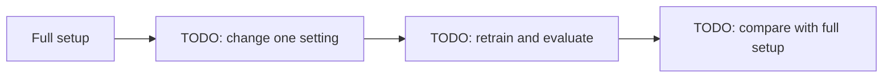

# Stage 08: Ablations

**Status:** Todo

Previous: [Stage 07: Evaluation](../stage-07-evaluation/README.md) | Home: [README](../../README.md) | Next: [Stage 09: Results and model card](../stage-09-results-and-model-card/README.md)

## Goal

Change one thing at a time and re-measure, to learn which choices matter.
The list of experiments is not chosen yet.

## Concepts

- [Ablation](../glossary.md#ablation).
- TODO: candidate changes, for example with or without near-dedup, with or without class balancing, different training sizes.

## Flowchart

## What the code does

TODO: no code yet.

## How to run

TODO

## Results

_fill after run_

## Common errors and fixes

TODO

## Self-check questions

TODO (3 to 5 questions)
