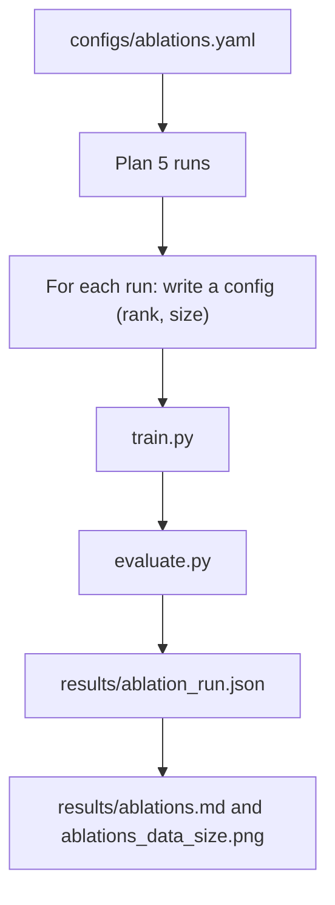

# Stage 08: Ablations

**Status:** In progress. The plan and script are written. No run has finished yet.

## Goal

I change one thing at a time (LoRA rank, or number of training examples) and measure again, to learn what matters.
The result is a table and a plot of performance against data size.

## Concepts

- An [ablation](../glossary.md#ablation) changes one setting and keeps the rest fixed, so any difference has one cause.
- LoRA rank 8, 16 and 64 test how much adapter capacity helps.
- Training sizes 500, 2000 and 5000 test how much data helps.
- The default plan is "one at a time" (5 runs). The rank runs use 2000 examples. The size runs use rank 16. The run with rank 16 and 2000 examples is shared. `mode: grid` would run all 9 combinations.
- A table of placeholders is not a result. The script now writes no table or plot until at least one run has metrics ([E10](../errors-and-fixes.md#e10)).

## Flowchart



## What the code does

- [configs/ablations.yaml](../../configs/ablations.yaml): base config `configs/qlora_main.yaml`, ranks 8, 16, 64, sizes 500, 2000, 5000, default rank 16, default size 2000, `alpha_multiplier: 2`, `attack_ratio: 1.0`.
- [src/run_ablations.py](../../src/run_ablations.py): builds the plan, writes one config per run (no Hub push, no mid-run checkpoints), calls `train.py` and `evaluate.py`, skips runs that already have metrics, continues after a failed run, then builds the markdown table and the plot of macro-F1 and ATT&CK exact match against data size. `--dry-run` prints the plan. `--only-report` rebuilds the report from existing metrics.

The five runs: `r8_n2000`, `r16_n2000`, `r64_n2000`, `r16_n500`, `r16_n5000`.

## How to run

On Colab:

```
python src/run_ablations.py --dry-run
python src/run_ablations.py
```

## Results and metrics

| Run | LoRA rank | Severity examples | Severity macro-F1 | ATT&CK exact match |
|---|---|---|---|---|
| r8_n2000 | 8 | 2000 | Pending | Pending |
| r16_n2000 | 16 | 2000 | Pending | Pending |
| r64_n2000 | 64 | 2000 | Pending | Pending |
| r16_n500 | 16 | 500 | Pending | Pending |
| r16_n5000 | 16 | 5000 | Pending | Pending |

When a run finishes, `results/ablations.md` holds the full table and `results/ablations_data_size.png` the plot. A size of 5000 uses fewer examples if the severity train file is smaller.

## Errors faced in this stage

- [E10](../errors-and-fixes.md#e10): the script wrote a results table although every run had failed.

## What I learned

- Never publish a table that has no measured numbers.
- Change one thing at a time. Otherwise I cannot say what caused a difference.

## Navigation

Previous: [Stage 07: Evaluation](../stage-07-evaluation/README.md) | [Home](../../README.md) | Next: [Stage 09: Results and model card](../stage-09-results-and-model-card/README.md)
