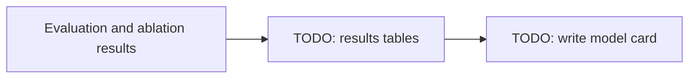

# Stage 09: Results and model card

**Status:** Todo

Previous: [Stage 08: Ablations](../stage-08-ablations/README.md) | Home: [README](../../README.md) | Next: [Stage 10: Extensions](../stage-10-extensions/README.md)

## Goal

Collect the final numbers in one place and write a [model card](../glossary.md#model-card).
Only numbers that were really measured go here.

## Concepts

- [Model card](../glossary.md#model-card).
- TODO: what to report (data used, metrics, limits, safe use).

## Flowchart

## What the code does

TODO: no code yet.

## How to run

TODO

## Results

_fill after run_

## Common errors and fixes

TODO

## Self-check questions

TODO (3 to 5 questions)
