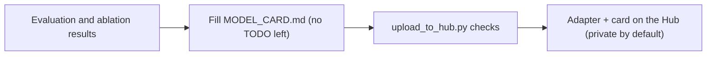

# Stage 09: Results and model card

**Status:** In progress. The model card is a draft and the upload script is written. There are no model results yet.

## Goal

I gather the final measured numbers in one place and publish the adapter with an honest [model card](../glossary.md#model-card).
Only numbers that were measured go in.

## Concepts

- A model card tells a reader what the model was trained on, how it was tested, what it is good and bad at, and how it should be used.
- Intended use here is defensive and educational work with public data only. It is not a replacement for the official CVSS score or analyst judgement, and not for building attacks.
- The card must state the limitations that I found: uneven classes, a mix of NVD and CNA labels, and a model that was trained to always answer with a label (see the [hallucination](../glossary.md#hallucination) check in stage 07).

## Flowchart



## What the code does

- [MODEL_CARD.md](../../MODEL_CARD.md): the draft card. It lists data sources, processing, planned training settings, an evaluation table, limitations and intended use. Every unmeasured value is marked `TODO`.
- [src/upload_to_hub.py](../../src/upload_to_hub.py): needs `HF_TOKEN`, checks that the adapter folder has `adapter_config.json` and weights, and refuses to upload while the card still contains `TODO` (override with `--allow-todo`). It uploads the adapter without checkpoints or optimizer files, and the card as the repo's `README.md`. The repo is private unless I pass `--public`.

## How to run

After training and evaluation:

```
python src/upload_to_hub.py --adapter outputs/qlora_main --repo-id <your-hub-user>/<repo-name>
```

## Results and metrics

| Item | Value |
|---|---|
| Final severity macro-F1 | Pending |
| Final ATT&CK exact match | Pending |
| Model card complete (no TODO left) | Pending |
| Adapter published | Pending |

## Errors faced in this stage

None yet. E10 ([errors-and-fixes.md](../errors-and-fixes.md#e10)) is the reason this stage shows "Pending" instead of a placeholder table.

## What I learned

- A model card is part of the result, not an extra.
- An upload script that refuses unfinished work is cheaper than correcting a published card.

## Navigation

Previous: [Stage 08: Ablations](../stage-08-ablations/README.md) | [Home](../../README.md) | Next: [Stage 10: Extensions](../stage-10-extensions/README.md)
