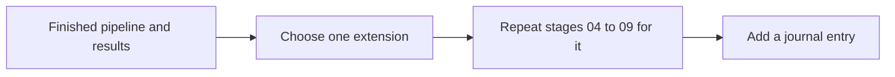

# Stage 10: Extensions

**Status:** Todo

## Goal

After the main pipeline works, I pick follow-up ideas and test them one by one.
Nothing here is planned in detail yet.

## Concepts

Ideas I may try, none started:

- Predict the [CWE](../glossary.md#cwe) id of a CVE (the data already holds CWE ids).
- Use other ATT&CK matrices (only Enterprise is used now).
- A larger base model, if the small one is limited.
- Compare NVD-scored and CNA-scored CVEs separately, since the label source is mixed ([stage 03](../stage-03-data-cleaning/README.md)).

## Flowchart

## What the code does

No code yet.

## How to run

Not applicable yet.

## Results and metrics

Pending. Nothing has run.

## Errors faced in this stage

None yet.

## What I learned

Pending.

## Navigation

Previous: [Stage 09: Results and model card](../stage-09-results-and-model-card/README.md) | [Home](../../README.md) | Next: none
