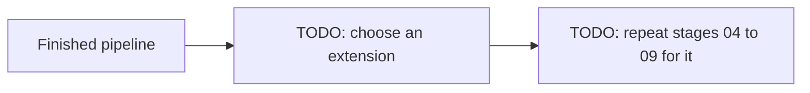

# Stage 10: Extensions

**Status:** Todo

Previous: [Stage 09: Results and model card](../stage-09-results-and-model-card/README.md) | Home: [README](../../README.md) | Next: none

## Goal

Pick follow-up ideas once the main pipeline works.
Nothing here is planned in detail yet.

## Concepts

- TODO: ideas to consider, for example predicting [CWE](../glossary.md#cwe) ids, other ATT&CK matrices, or a larger base model.

## Flowchart

## What the code does

TODO: no code yet.

## How to run

TODO

## Results

_fill after run_

## Common errors and fixes

TODO

## Self-check questions

TODO (3 to 5 questions)
